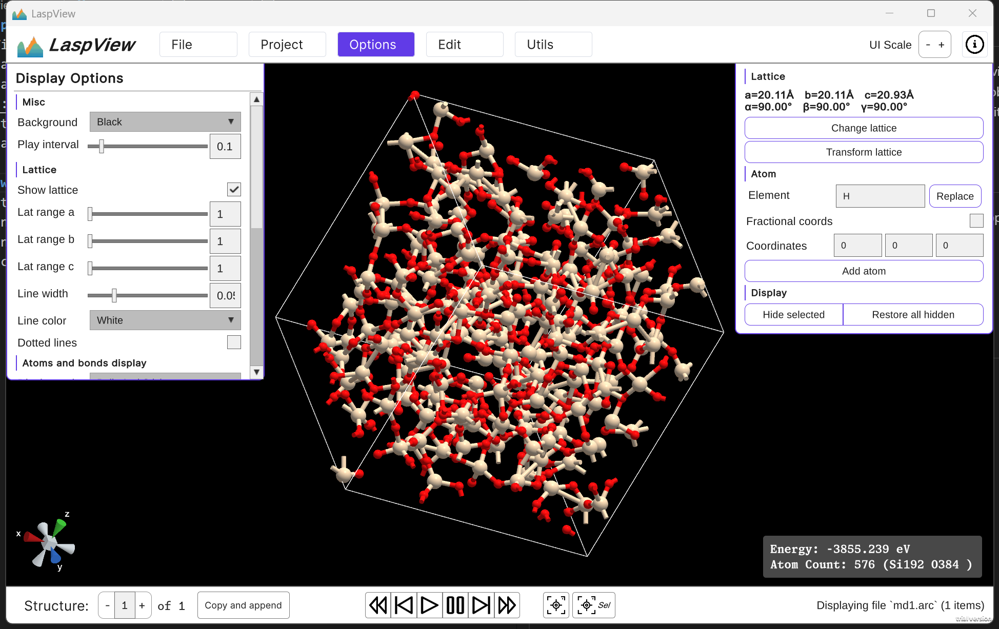
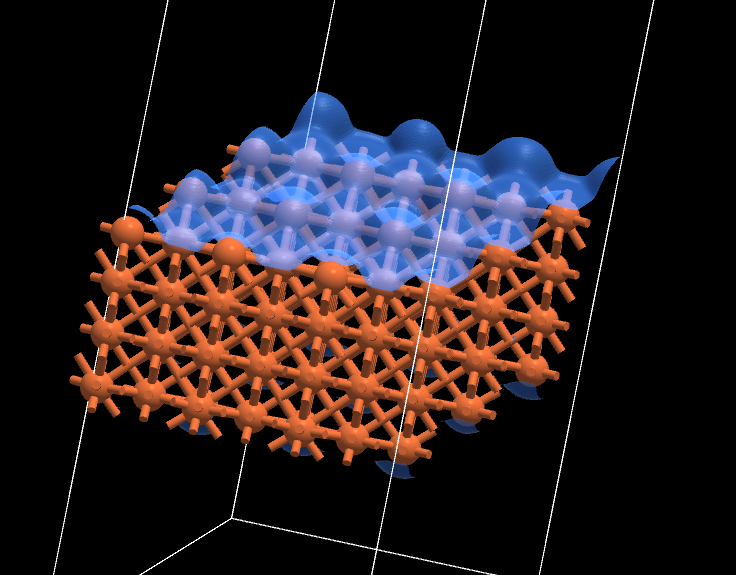
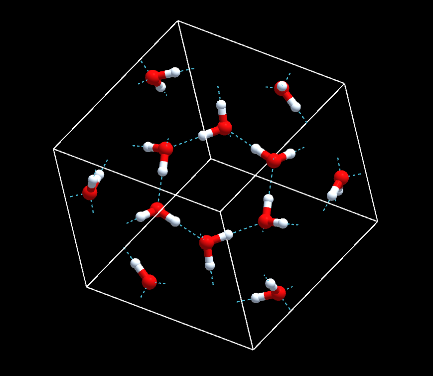
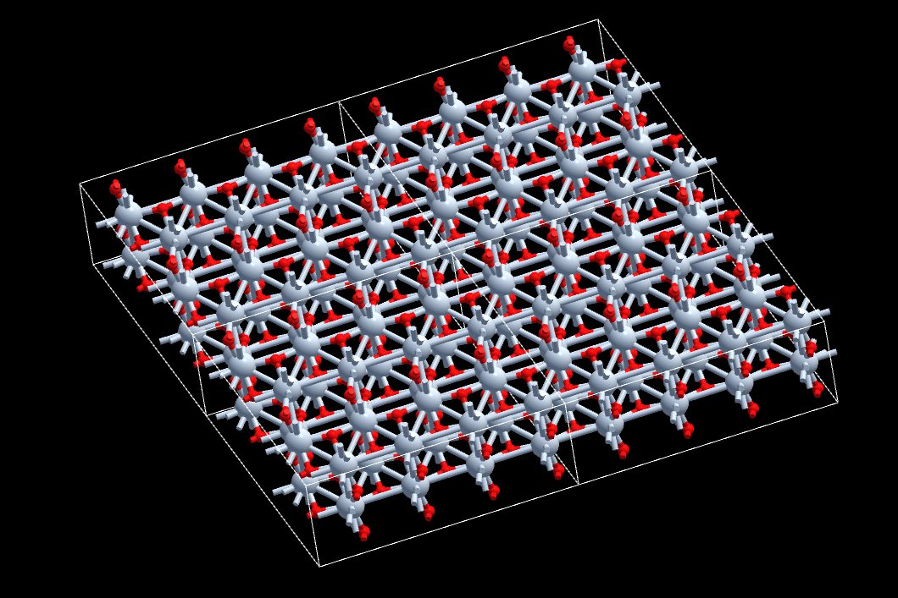

# LaspView

**A high-performance crystal visualization and editing software for LASP and all**

[Try the online version on our AI-powered cloud computing platform: LASPAI](https://www.laspai.com/#/laspview/globalopt)

LaspView is a graphical user inferface (GUI) software for crystal editing and visualization.  
It started as a GUI application specially tailored for [LASP](http://www.lasphub.com/#/lasp/laspHome) (a NN-powered global potential surface searching tool), but it can also serve as a general-purpose crystal editing tool (like VESTA). 

## Installation
Head to [Releases](https://github.com/HydrogenC/laspview-release/releases) and download the build for your platform. Currently supported platforms are: 
 - Windows x64
 - Mac OS (Unified build for Intel and M-series)

Linux build not supplied by now. Contact us if you need it. 

Refer to the in-application tutorial (by clicking the "About" button on the top-right corner of the UI) for mouse operations and hotkeys. 

## Features
### 📄 Supported file formats
 - CIF: Read/Write
 - ARC/CAR: Read/Write
 - POSCAR (VASP crsytal format): Read/Write
 - CHGCAR: planned, not yet implemented
 - EXTXYZ: Read-only
 - Gaussian CUBE: Read-only (including surface)
 - MOL (Both V2000 and V3000): Read-only
 - XYZ: Read-only

### 🔧 Editing features
 - Multiple crystal file format support (cif, arc, poscar, CAR, etc.)
 - Real-time bonding calculation based on van-der-Waals radii
 - Atomic selection, addition, manipulation, and deletion
 - Batch atomic operations (translation, rotation)
 - Crystal lattice parameter adjustment
 - Cell/lattice transformation through transform matrix
### 🖥️ Rendering features
 - High performance renderer, fluent even on mega lattices
 - Structure frame sequence rendering, helpful to MD or reaction pathway visualization
 - Equipotential surface rendering for supported formats (CUBE) via Marching Cubes  

 - Hydrogen bond calculation and visualization

 - Configurable display - display ball/sticks, ball/stick size, etc
 - Hide selected atoms to show deep-level crystal details
 - Multi-cell rendering

### ✨ Utilities
 - High-resolution rendering export for publication-ready figures
 - Export animation videos for frame sequences
 - Realtime updated chemical formula

## Benchmarks
| Atomic Count | Frame Rate (FPS) | Notes |
|--------------|------------------|-------|
| 10,000 | 60+ | Smooth editing experience |
| 50,000 | 40+ | High-performance rendering |
| 100,000 | 25+ | Real-time interaction possible |

Tested on i9-13900HX / RTX4070. 

## Support
Users in China could seek support on the support channel on [LASPAI](https://www.laspai.com/#/dashboard) or directly creating issues in the repository.  
Users overseas could seek support by posting a issue here in this repository. 
